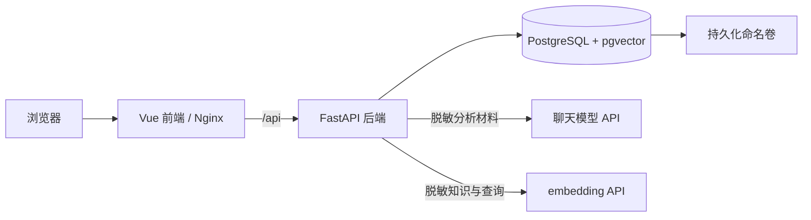
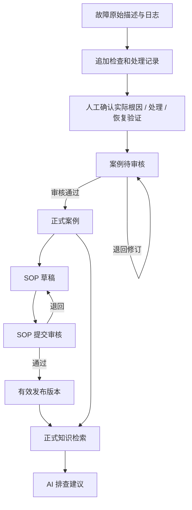

# OpsSOP 系统架构

适用版本：3.5.1。

OpsSOP 使用单体后端、独立前端与 PostgreSQL 数据库。业务数据和向量索引保存在应用部署所在地，聊天与 embedding 服务通过适配层独立接入。运行基础业务不需要 GPU 或模型服务。

## 组件与部署

| 组件 | 技术与职责 | 代码入口 |
|---|---|---|
| 前端 | Vue 3、TypeScript、Vite、Element Plus、Tailwind；工作台、故障、案例、SOP 与管理 | `frontend/src/` |
| API | FastAPI；认证、权限、状态流转、审计和业务事务 | `backend/app/main.py`、`routers/` |
| 数据层 | SQLAlchemy、Alembic、PostgreSQL；业务表、索引与迁移 | `backend/app/models.py`、`backend/alembic/` |
| 模型适配 | OpenAI 兼容聊天/embedding、模式控制、脱敏、固定 Schema | `backend/app/ai/` |
| 知识检索 | 关键词、pgvector、排名融合、索引代次与来源复核 | `backend/app/search/` |
| 评测 | 版本化数据、隔离数据库、分组指标与报告 | `backend/app/eval/`、`backend/eval_data/` |
| 运维 | 备份、恢复、生产预检与隔离演练 | `backend/app/ops/`、`backend/scripts/ops_cli.py` |

Docker Compose 运行前端、后端、数据库三项服务。Nginx 提供静态资源并代理 API；PostgreSQL 使用命名卷持久化。生产覆盖配置限制对外端口，由部署方提供 HTTPS 入口，详见 [部署指南](deployment.md)。

## 业务数据流

原始描述和检查记录、人工确认根因、案例、SOP、AI 分析记录分别保存。AI 报告不直接改变故障状态或人工确认内容。确认解决会在业务事务中标记故障并生成待审核案例；审核通过后才进入正式诊断知识。

SOP 以 `doc_id` 表示文档、`version` 表示版本，每个版本独立存储。新草稿不影响当前发布版本；新版本审核发布时，原发布版本转为历史版本。反馈与审计记录另行保存。

## 分析与检索路径

1. 前端提交故障 ID、当前输入和请求版本；后端检查身份及故障访问权限。
2. 后端组织证据标识，限制上下文长度，检索当前用户有权使用的正式案例与有效 SOP。
3. 关键词检索独立运行；embedding 可用时取得查询向量，使用数据库向量距离排名，并通过 RRF 融合两路排名。
4. 发送模型前再次复核来源状态和版本，脱敏后调用配置的聊天适配器。
5. 模型输出通过固定 Schema 校验，证据 ID、来源 ID 和版本经后端复核；无效引用移除并标记信息不完整。
6. 前端仅应用仍对应当前故障、输入及配置的结果。过期、取消或倒序响应不能覆盖新内容。

分析缓存绑定输入、知识版本、模型配置与检索代次；缓存命中仍复核来源权限和状态。AI 异常返回明确失败，不回退模拟答案；embedding 异常可降级关键词，并保留降级原因。

AI 生成 SOP 使用独立输出 Schema 和生成记录，仅以指定已通过案例为依据。模型返回后再次校验来源快照，再创建草稿。`request_token` 防止同一次生成重试重复创建草稿。

## 索引生命周期

每个知识来源生成一个索引单元，记录类型、ID、SOP 版本、内容指纹、模型配置指纹、向量维度与代次。索引构建由管理员触发，数据库原子领取保证同一时刻只有一个有效构建执行者。

构建结果在完整生成并校验后激活；半成品不作为正式索引。查询绑定活动代次，来源内容变化、权限或发布状态变化会触发剔除。更换模型、端点或文本版本需要重建，不能只按向量维度判断兼容。

## 权限与信任边界

- 登录使用带有效期的 JWT Bearer 令牌；后端在每次请求读取当前账号的启用状态及角色。密码使用 bcrypt 哈希保存。
- 运维人员处理自己的故障和未审核材料；审核人员与管理员拥有审核权限。正式知识的可见性与原始故障的私有数据权限分开执行。
- 模型输出和用户日志均为不可信数据。命令只展示，不由应用执行；SOP 发布、废弃和人工解决均由有权限的人员主动触发。
- Markdown 先转义原始 HTML，再执行有限格式转换；来源链接由后端校验后的类型、ID 和版本构造。
- 密钥只由后端环境变量提供；`LOCAL_ONLY` 同时约束聊天和 embedding。需要网络隔离时由部署环境执行出口控制。
- 创建、处理、审核、发布及管理操作保留审计记录。

3.5.1 面向单后端实例部署；单用户模型限流和并发计数保存在进程内。扩展多实例时需补充统一限流及相应运行策略。

配置细节见 [AI 配置指南](ai-configuration.md)，恢复策略见 [备份恢复](backup-restore.md)，质量指标见 [评测指南](evaluation.md)。
